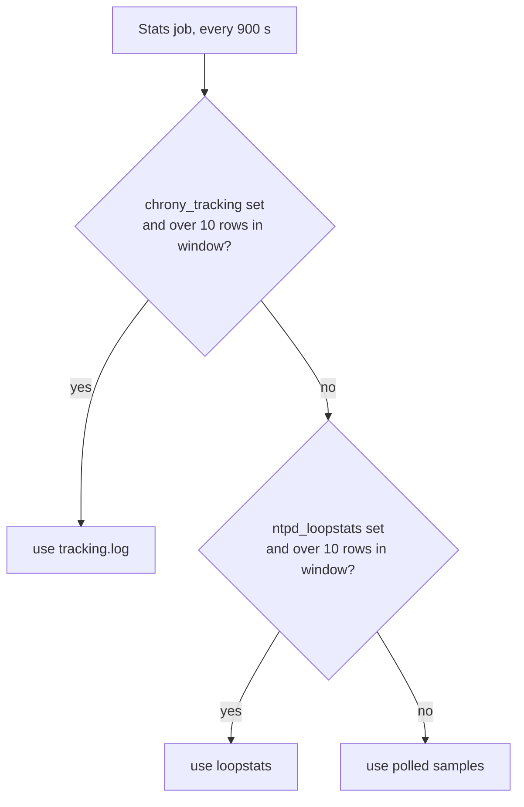

# Daemon logs

The Stats tab normally works from the samples the collector polls once a minute. That limits the Allan deviation to averaging times of 60 seconds and up, and history starts the day you installed the collector.

chrony and ntpd can both log every clock update to a statistics file. When the collector can read that file, the Stats tab uses it for the offset and frequency statistics, the histogram and the Allan deviation. Neither daemon writes these logs by default. The collector never changes daemon config, so turn the log on yourself and then tell the collector where it is.

This works with `source.type = "local"` only, since the collector reads the file from local disk.

## chrony

Add to `/etc/chrony/chrony.conf`:

```text
log tracking
logdir /var/log/chrony
```

Restart chronyd, then set:

```toml
[logs]
chrony_tracking = "/var/log/chrony/tracking.log"
```

## ntpd or ntpsec

Add to `/etc/ntp.conf` (or `/etc/ntpsec/ntp.conf`):

```text
statsdir /var/log/ntpstats/
statistics loopstats
```

Restart ntpd, then set:

```toml
[logs]
ntpd_loopstats = "/var/log/ntpstats/loopstats"
```

## How the collector reads them



- Rotated files next to the live one are read too: `tracking.log.1`, `loopstats.20261124` and so on. Compressed files (`.gz`, `.xz`, `.bz2`) are skipped.
- The sample spacing for the Allan deviation is the median gap between log rows. The Stats tab shows it as "sample spacing" next to the source name.
- chrony logs offset as local clock minus reference. The collector flips the sign so it matches `ntpq` and the rest of the page.
- The file needs to be readable by the `gnssgraphs` user.
- Only the offset and frequency figures come from the log. Jitter, root delay, root dispersion, GNSS and peer statistics still come from polled samples.

The line under the Stats window buttons says which source is in use, for example `offset source: chrony tracking.log, sample spacing 16s`.
