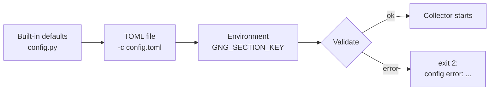

# Configuration

The collector reads one TOML file, `/etc/gnss-ntp-graphs/config.toml` on an `install.sh` setup. `deploy/config.toml` in the repository lists every key with its default and a comment, shown in full under [Full template](#full-template). Your own file only needs the keys you change.

```toml
[source]
type = "local"

[web]
title = "Garage time server"
offset_unit = "us"
```

Restart the service after editing: `sudo systemctl restart gnss-ntp-graphs`. The page settings are written to `data/config.json` once at start, so a browser reload alone does not pick up a change.

## Where values come from



Each layer overrides the one before it. Any key outside `[graphs]` can be set from the environment as `GNG_<SECTION>_<KEY>` in upper case:

```bash
GNG_SOURCE_TYPE=local
GNG_SOURCE_BRIDGE_URL=http://192.168.1.50/
GNG_WEB_SECTIONS=ntp,peers          # lists are comma-separated
GNG_WEB_OFFSET_LINES=-0.01,0.01
GNG_SERVER_SERVE=true               # true/false, yes/no, on/off or 1/0
```

The Docker image uses this to set its paths and port.

## Validation

The collector checks the whole config before it starts and stops with a message naming the problem. A typo cannot silently fall back to a default. Some examples:

```text
config error: [web] colour: unknown key, allowed ['colourblind_safe', 'columns', ...]
config error: [source] type: 'gps' not one of ['bridge', 'local']
config error: [web] default_range: '12h' is not in ranges ['2h', '8h', '24h', '7d', '30d', '1y']
config error: [intervals] ntp: expected int, got '60'
```

It refuses unknown sections and keys, values of the wrong type, choices outside the allowed set, unknown section, range or graph ids, and a palette that is not colourblind safe when `colourblind_safe = true`. Under systemd the message goes to the journal (`journalctl -u gnss-ntp-graphs`).

## Sections

| Section | Page | Controls |
|---|---|---|
| `[source]` | [Collector](collector.md#source) | Which source, bridge URL, daemon, gpsd address |
| `[intervals]` | [Collector](collector.md#intervals) | Poll, export, rollup and stats timers |
| `[paths]` | [Collector](collector.md#paths) | Database and web root locations |
| `[retention]` | [Collector](collector.md#retention) | How long each storage tier is kept |
| `[server]` | [Collector](collector.md#server) | Built-in web server |
| `[web]` | [Web page](web-page.md) | Everything the page shows and how |
| `[graphs.<id>]` | [Web page](web-page.md#fixed-y-axis-limits) | Fixed y-axis limits per graph |
| `[logs]` | [Daemon logs](daemon-logs.md) | chrony or ntpd statistics logs for the Stats tab |

## Full template

Every key with its default. Copy the lines you want to change into `/etc/gnss-ntp-graphs/config.toml`, or into `config.docker.toml` for [Docker](../install/docker.md).

```toml
--8<-- "deploy/config.toml"
```
