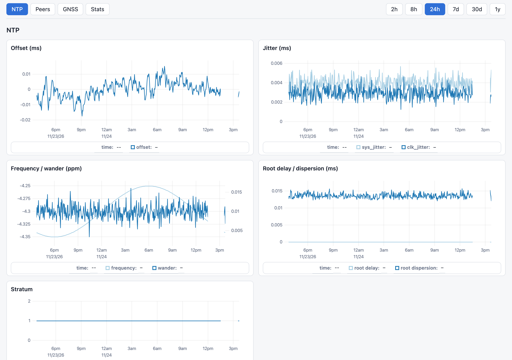
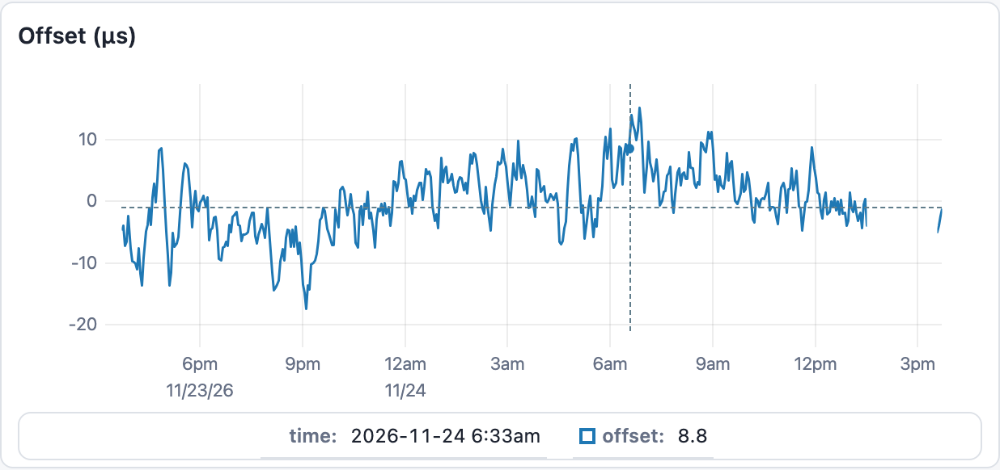
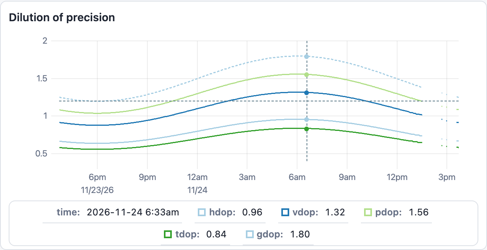

# Web page settings

The `[web]` section decides what the page shows and how it looks. Where graphs1090's `default` file has a matching option, the table names it. The collector writes these values to `data/config.json` when it starts, so restart it after a change.

## Title and links

| Key | Default | graphs1090 | Meaning |
|---|---|---|---|
| `title` | `"GNSS NTP"` | `WWW_TITLE` | Page heading. The browser tab shows it followed by "graphs" |
| `header` | `""` | `WWW_HEADER` | A line under the heading. Empty hides it |
| `repo_url` | GitHub repository | | Link behind the GitHub icon. Empty hides the icon |
| `docs_url` | this site | | Link behind the book icon. Empty hides the icon |

## Layout

| Key | Default | graphs1090 | Meaning |
|---|---|---|---|
| `layout` | `"tabs"` | | `tabs` shows one section at a time. `single` stacks all sections on one page, keeps the whole header on top while scrolling, and the buttons scroll to the sections |
| `sections` | `["ntp", "peers", "gps", "stats"]` | `HIDE_SYSTEM` | Which sections appear, in this order |
| `hide_graphs` | `[]` | | Graph ids to leave out (list below) |
| `graph_height` | `220` | `graph_size` | Plot height in pixels. The stratum graph is 75% of this |
| `columns` | `"auto"` | `all_large` | Graphs per row: `"auto"` fits the width, or `1`, `2`, `3`. Phones always get one |
| `font_size` | `14` | `font_size` | Base font size in pixels. Axis labels use 80% of it |
| `cursor` | `"hover"` | | `hover` shows values under a graph only while the pointer is over it. `last` marks the newest point with a dashed line and shows its values under each graph. Hovering still works, and the values go back to the newest point when the pointer leaves |



Graph ids for `hide_graphs` and `[graphs.<id>]`:

| Section | Ids |
|---|---|
| NTP | `offset`, `jitter`, `freq`, `root`, `stratum`, `temp` |
| Peers | `peer-offset`, `peer-delay`, `peer-jitter`, `peer-reach` |
| GNSS | `sats`, `const`, `ss`, `dop`, `sky` |
| Stats | `hist`, `adev`, `temp-freq`, `temp-offset` |

## Time and units

| Key | Default | graphs1090 | Meaning |
|---|---|---|---|
| `ranges` | `["2h", "8h", "24h", "7d", "30d", "1y"]` | | Which range buttons appear. The collector only writes files for these |
| `default_range` | `"24h"` | | Range shown on a viewer's first visit. Must be in `ranges` |
| `timezone` | `"local"` | `TZ` | Time axis zone: `local` (the viewer's browser), `UTC`, or an IANA name such as `Europe/London` |
| `offset_unit` | `"ms"` | | `ms` or `us` for offset, jitter, delay and dispersion, on graphs and in tables |
| `offset_lines` | `[]` | `max_messages_line` | Dashed horizontal lines on the offset graph, in ms, for example `[-0.01, 0.01]` |

The page remembers the last range a viewer picked, in their browser.



## Status colours

The header status line colours two values green, amber or red. See [Status line](../readouts/index.md#status-line).

| Key | Default | Meaning |
|---|---|---|
| `offset_warn_ms` | `1.0` | Offset magnitude in ms at which it turns amber |
| `offset_bad_ms` | `10.0` | Offset magnitude in ms at which it turns red |
| `stale_warn_s` | `120` | Age in seconds at which "updated" turns amber |
| `stale_bad_s` | `300` | Age in seconds at which "updated" turns red |

## Peers

| Key | Default | Meaning |
|---|---|---|
| `max_peers` | `16` | Most peers drawn per graph. Peers with the most data in the range win |
| `hide_peers` | `[]` | Peers never drawn, by address or name as the peer table shows it, for example `["NMEA"]` |

An NMEA refclock usually has an offset far larger than the other sources (about 110 ms in the screenshots), which squashes their lines against zero. Hiding it is a common choice. The peer table and the Stats tab still list hidden peers.

## Theme and colours

| Key | Default | graphs1090 | Meaning |
|---|---|---|---|
| `theme` | `"auto"` | `colorscheme` | `auto` follows the viewer's system setting. `light` or `dark` sets the starting theme |
| `palette` | `"Paired"` | | Line colours, from the [ColorBrewer](https://colorbrewer2.org) qualitative schemes |
| `colourblind_safe` | `false` | | Limit colours to the sets ColorBrewer rates colourblind safe |

Viewers can switch theme with the button in the header. Their browser remembers the choice, and it overrides `theme`.

Allowed palettes are `Accent`, `Dark2`, `Paired`, `Pastel1`, `Pastel2`, `Set1`, `Set2` and `Set3`. Each graph takes as many colours as it has lines (at least three), up to the scheme's largest set. A graph with a single line uses the scheme's second colour, which in `Paired` is the darker blue. When a graph has more lines than the scheme has colours, the extra lines reuse the colours with dashed strokes.

With `colourblind_safe = true` only three palettes are accepted: `Paired` (up to 4 colours), `Dark2` and `Set2` (3 colours each). Lines past that count are dashed. The DOP graph below has five lines with `Paired` limited to four colours, so the fifth is dashed:



The sky plot draws dots, which cannot be dashed, so there the satellite numbers tell constellations apart when colours repeat.

## Fixed y-axis limits

By default every graph scales to its data. To fix an axis, add a table per graph id with `y_min`, `y_max` or both, in the unit the graph displays (graphs1090 `ul_*` and `ll_*`):

```toml
[graphs.offset]
y_min = -0.05
y_max = 0.05

[graphs.dop]
y_max = 3
```

With `offset_unit = "us"` the offset limits are in microseconds. The `[graphs]` tables cannot be set from the environment.
