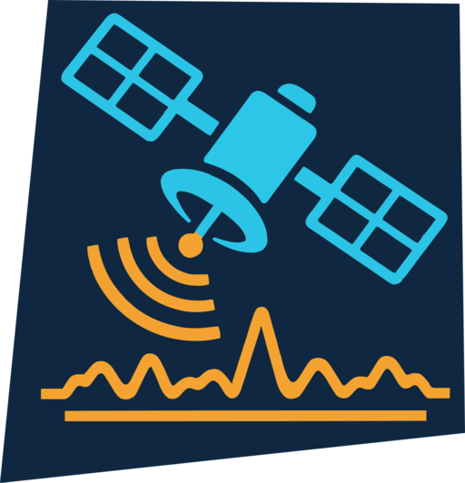
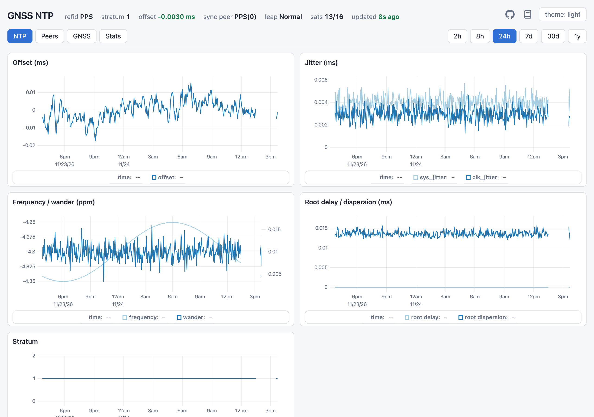
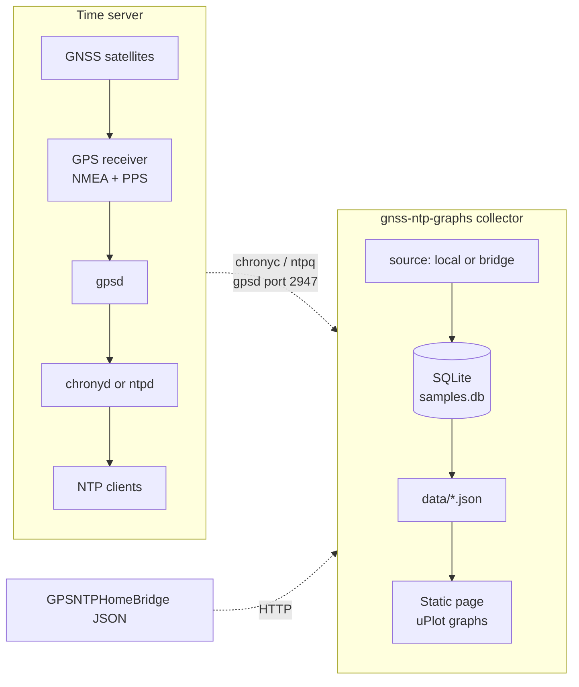

# GNSS NTP Graphs

GNSS NTP Graphs draws history graphs for a GPS-disciplined NTP server, in the style of [graphs1090](https://github.com/wiedehopf/graphs1090). A small Python collector polls chrony or ntpd and gpsd, stores the readings in SQLite and writes JSON files. A static page in the browser turns those files into graphs.

It runs next to [GPSNTPHomeBridge](https://github.com/ToledoEM/GPSNTPHomeBridge), the bridge that feeds the same server into Home Assistant, and leaves it alone. It needs Python 3.11 or newer and no pip packages.

## How the pieces fit

The collector reads the server one of two ways. On the Pi with the receiver it runs `chronyc` or `ntpq` and opens a client connection to gpsd. On any other machine it fetches the JSON files the bridge already publishes. Both paths map the fields the same way, so the graphs match. [Choosing a source](install/index.md) explains the difference.

## What the page shows

| Tab | Graphs |
|---|---|
| [NTP](readouts/ntp.md) | System offset, jitter, frequency and wander, root delay and dispersion, stratum |
| [Peers](readouts/peers.md) | Offset, delay, jitter and reach for each source, plus a table of the current peers |
| [GNSS](readouts/gnss.md) | Satellites used and visible, used satellites per constellation, average signal, DOP, sky plot |
| [Stats](readouts/stats.md) | Percentile tables, offset histogram and Allan deviation over 24 hours and 7 days |

The header carries a live status line for the server. [Reading the graphs](readouts/index.md) covers it field by field.

## Where to go next

- [Install](install/index.md) on a Raspberry Pi, a Debian host or in Docker.
- [Configuration](configuration/index.md) for the collector and for the page.
- [How it works](reference/architecture.md) for the storage tiers, timers and data files.
