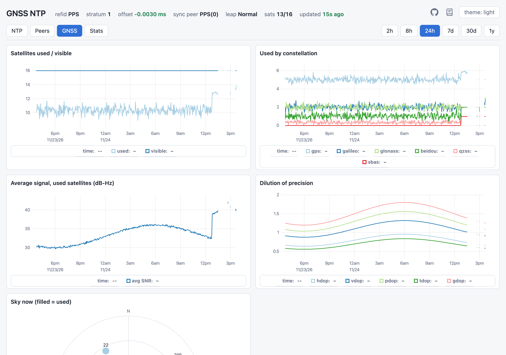
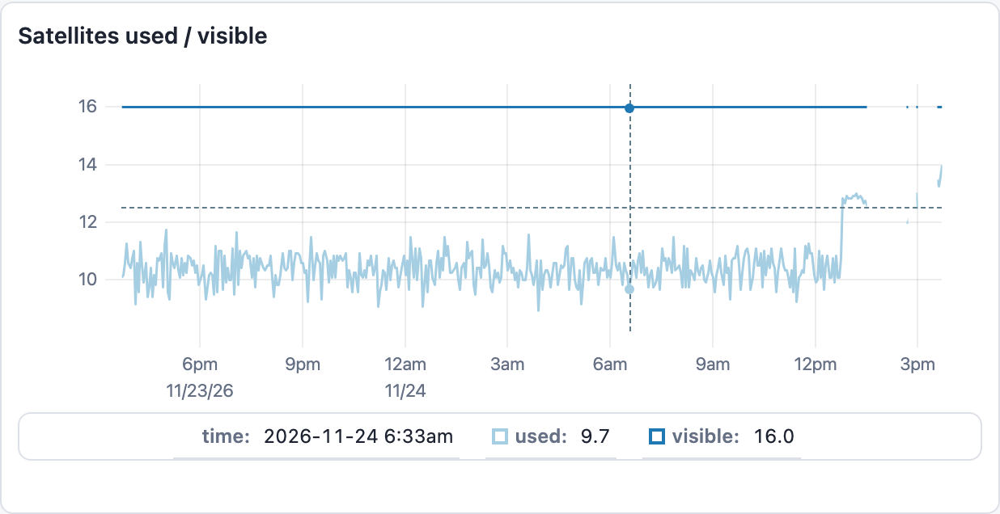
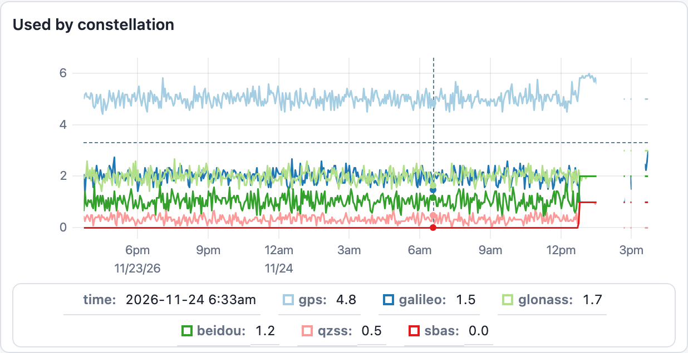
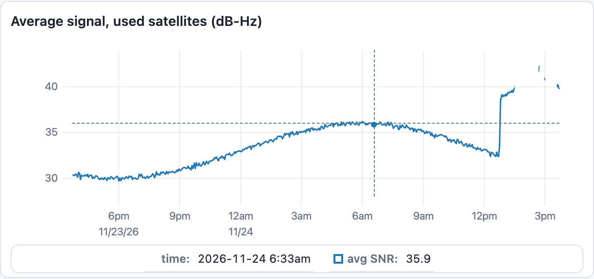
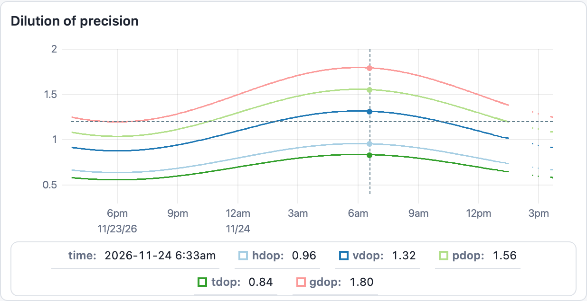
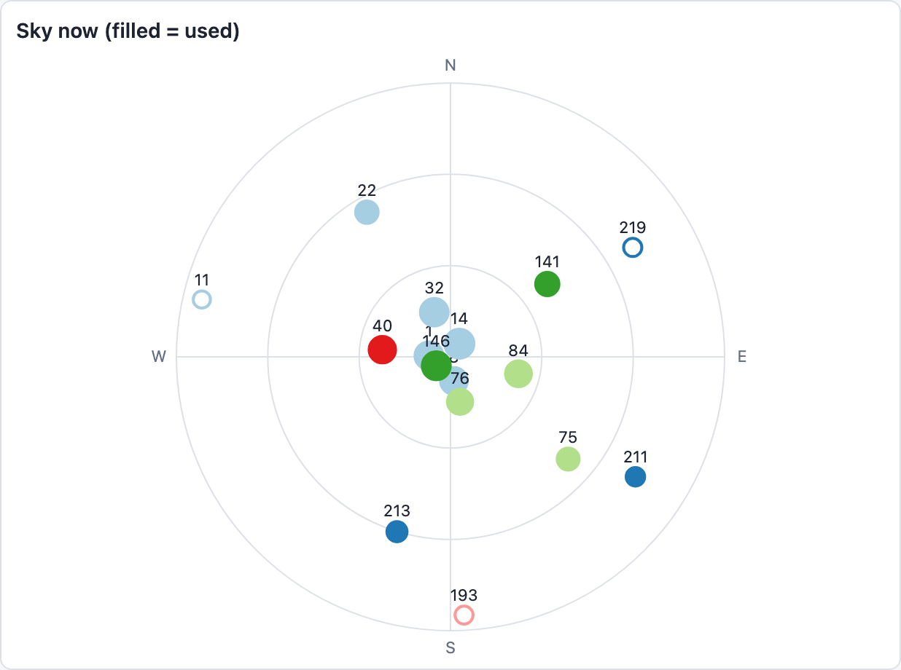

# GNSS

The GNSS tab shows the receiver's view of the sky, from gpsd's `SKY` reports. With the `bridge` source the same data arrives through the bridge's `gps.json`. The collector polls it every 15 seconds.

A timing receiver needs fewer satellites than a navigation receiver, especially once its position is fixed, but more satellites with good geometry make the PPS edge steadier and keep the server on stratum 1 through partial sky blockage.

## Satellites used and visible

`visible` counts every satellite in the report. `used` counts those the receiver includes in its solution. Values are averaged per bucket, so they can be fractional.

Some distance between the two lines is normal: low satellites and weak signals are tracked but left out. A drop in `used` at the same time each day often points to a building or tree blocking part of the sky. If the receiver loses the sky or gpsd stops answering, the collector stores no GPS sample and the graph shows a gap.

## Used by constellation

Satellites in use per system: `gps`, `galileo`, `glonass`, `beidou`, `qzss`, `sbas` and `navic`. Only constellations seen during the range get a line. The constellation comes from gpsd's `gnssid` field, and each constellation keeps its colour across this graph and the sky plot.

Which systems appear depends on the receiver model and its configuration. A receiver set to GPS only shows one line.

## Average signal

The mean signal strength (carrier-to-noise density, `ss` in gpsd) of the satellites in use, in dB-Hz. With a roof antenna, values in the 30s and 40s are typical. Values in the 20s suggest a poor antenna position, a long or damaged cable, or interference. A daily dip that matches the satellite count usually means part of the sky is blocked.

## Dilution of precision

DOP values describe how the geometry of the satellites in use multiplies measurement error. Lower is better. Values under 1 are excellent and under 2 are good.

| Line | Covers |
|---|---|
| `hdop` | Horizontal position |
| `vdop` | Vertical position |
| `pdop` | 3D position |
| `tdop` | Time |
| `gdop` | Position and time together |

For a time server TDOP matters most. It rises when few satellites are in use or they cluster in one part of the sky.

## Sky now

A polar plot of the latest `SKY` report. It always shows the current view and ignores the range buttons.

- North is up and east is right. The centre is straight overhead (90° elevation). The rings mark 60°, 30° and the horizon.
- Each circle is a satellite, labelled with its PRN number and coloured by constellation.
- A filled circle is in use. A hollow circle is visible but not used.
- Circle size follows signal strength, from smallest at 10 dB-Hz or below to largest at 50 dB-Hz.
- Satellites below the horizon or without a position are left out.

Hollow circles near the outer ring are expected: receivers usually skip satellites below an elevation mask. A cluster of hollow or small circles in one direction shows where the antenna's view is blocked. If the plot reads "no satellite data", gpsd returned no satellites in its last report.
