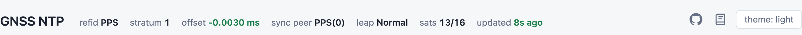
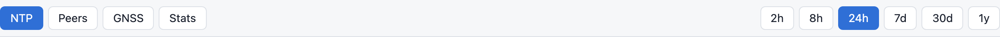
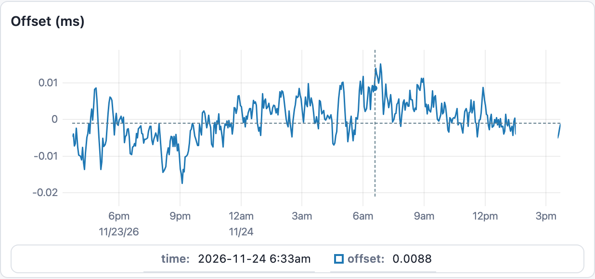
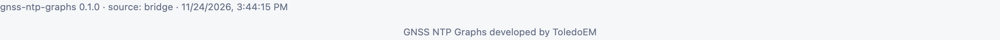

# Reading the graphs

The page has a header with a live status line, a row of section tabs and range buttons, and the graphs of the chosen section.

## Status line

The status line shows the newest readings from `data/current.json`. It does not follow the range buttons.

| Field | Meaning |
|---|---|
| refid | Reference the server is locked to. `PPS` or `GPS` for a receiver, an IP address when it follows another server |
| stratum | 1 when locked to the receiver. Higher means it follows a network server. 16 or 0 means not synchronised |
| offset | System clock offset from its reference, in the [offset unit](../configuration/web-page.md#time-and-units) |
| sync peer | The peer marked `*` in the peer table, or `none` |
| leap | Leap second status: `Normal`, `Insert second`, `Delete second` or `Not synchronised` |
| sats | Satellites used / visible in the latest gpsd `SKY` report |
| updated | Seconds since the collector last wrote `current.json` |

Two fields change colour:

| Field | Green | Amber | Red |
|---|---|---|---|
| offset | below `offset_warn_ms` (1 ms) | below `offset_bad_ms` (10 ms) | at or above `offset_bad_ms` |
| updated | up to `stale_warn_s` (120 s) | up to `stale_bad_s` (300 s) | over `stale_bad_s` |

The limits are [configurable](../configuration/web-page.md#status-colours). A red "updated" means the collector has stopped writing, or the browser cannot reach the files. The page works out the age from the viewer's own clock, so a badly set clock on the viewing device also shows up here.

If the page cannot load `current.json` at all, the status line shows `No data yet:` followed by the error, for example `current.json: 404` before the first export.

## Tabs and ranges

The tabs switch between the [NTP](ntp.md), [Peers](peers.md), [GNSS](gnss.md) and [Stats](stats.md) sections. The address bar follows the tab (`#ntp`, `#peers`, `#gps`, `#stats`), so you can bookmark a section. With `layout = "single"` all sections sit on one page and the buttons scroll to them.

The range buttons pick the time span: 2 hours, 8 hours, 24 hours, 7 days, 30 days or 1 year. Each range averages samples into buckets:

| Range | Bucket | Storage tier read |
|---|---|---|
| 2h | 30 s | raw |
| 8h | 1 min | raw |
| 24h | 3 min | raw |
| 7d | 20 min | raw |
| 30d | 1 h | 5-minute averages |
| 1y | 6 h | hourly averages |

Longer ranges therefore smooth out short spikes. Zoom into a shorter range to see them. A bucket with no samples is left empty, so outages show as gaps in the line. The Stats tab has its own 24h and 7d buttons and hides the range buttons.

## Using a graph

- Hover over a graph to read exact values in the legend below it.
- Drag across a graph to zoom the time axis. Double-click to zoom back out.
- Click a legend entry to hide or show that line.
- The page reloads its data every 60 seconds. Resizing the window redraws the graphs.

The theme button cycles through `auto`, `light` and `dark`. The browser remembers the choice, along with the last tab and range.

## Footer

The footer shows the collector version, the source type (`bridge` or `local`) and when the shown data was written.

