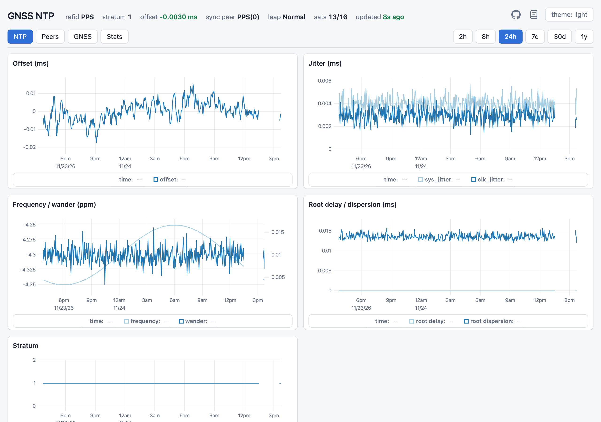
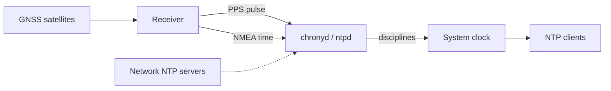
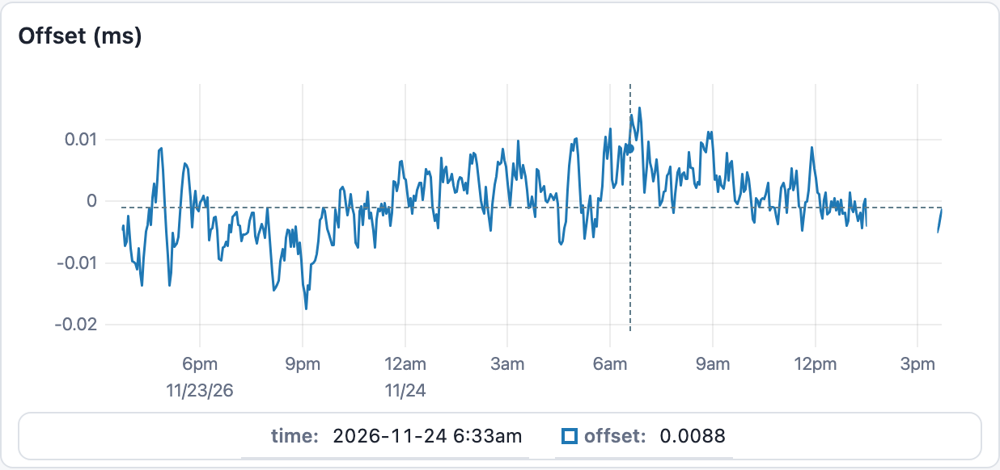
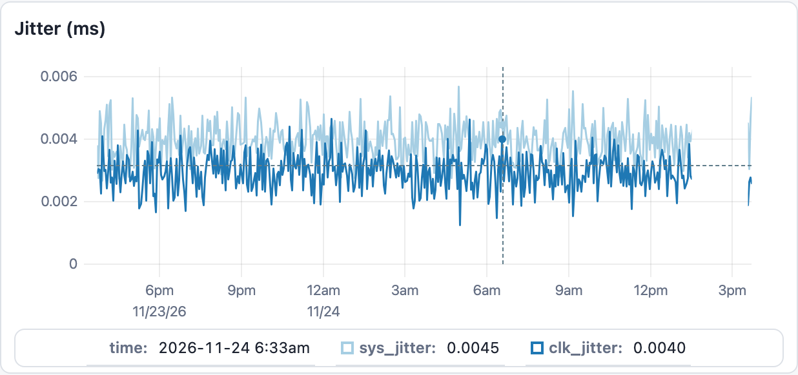
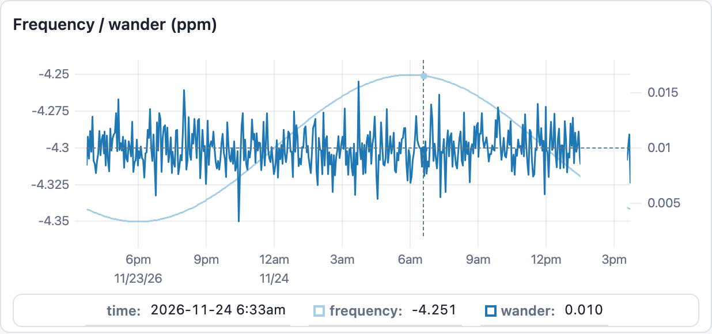
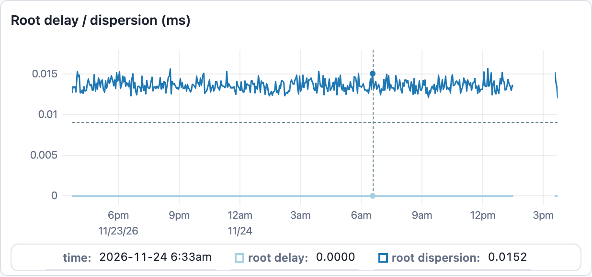
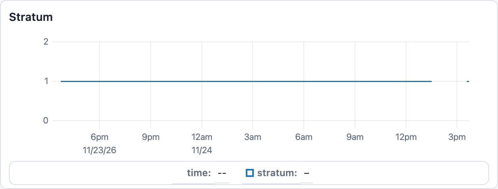

# NTP

The NTP tab shows how well the server's own clock follows its reference. All five graphs come from the system variables: `chronyc tracking` for chrony, `ntpq -c rv` for ntpd.

The receiver's pulse-per-second (PPS) output marks the start of each second precisely, and the NMEA sentences say which second it is. The daemon steers the system clock towards that reference. These graphs show how far off the clock is, how noisy the measurement is, and how hard the daemon has to steer.

## Offset

The difference between the system clock and the reference at each update. The sign follows `ntpq`: positive means the reference is ahead of the local clock.

| | |
|---|---|
| Unit | ms or µs (`offset_unit`) |
| chrony | Last offset from `tracking`, sign flipped to match `ntpq` |
| ntpd | `offset` from `ntpq -c rv` |

A PPS-locked server usually stays within tens of microseconds of zero, as in the screenshot (±0.02 ms). A slow wave over the day often follows room temperature. Steps or spikes come from the reference changing, the receiver losing lock, or the daemon falling back to network servers. The `offset_lines` setting draws dashed reference lines, for example at your accuracy target.

## Jitter

Two measures of short-term noise in the offset.

| Line | chrony | ntpd |
|---|---|---|
| `sys_jitter` | RMS offset from `tracking` | `sys_jitter`: combined jitter of the selected sources |
| `clk_jitter` | Standard deviation of the sync source from `sourcestats` | `clk_jitter`: jitter of the clock discipline |

Flat, low jitter means a clean PPS signal. A jump in jitter with a steady offset usually means a noisier reference, such as a switch from PPS to NMEA or to a network server.

## Frequency and wander

`frequency` (left axis) is the correction in parts per million the daemon applies to the local oscillator. A crystal is never exactly on frequency, so a steady value of a few ppm is normal. The correction moves with temperature, which shows as a daily wave or as a step when a fan or heater switches on.

`wander` (right axis) is the daemon's estimate of how unstable that frequency is. ntpd reports it as `clk_wander`. For chrony the collector uses the `skew` value from `tracking`, as the bridge does. Lower is steadier.

| | |
|---|---|
| Unit | ppm |
| chrony | `frequency` and `skew` from `tracking` |
| ntpd | `frequency` and `clk_wander` from `ntpq -c rv` |

## Root delay and dispersion

`root delay` is the total round-trip network delay from this server back to the stratum 0 reference. For a server locked to its own receiver it is zero, as in the screenshot. It rises when the server follows a network source.

`root dispersion` is the daemon's running estimate of the maximum error relative to the reference. It grows between updates and resets as new samples arrive. Together they bound how wrong the clock can be: the error stays within root dispersion plus half the root delay.

| | |
|---|---|
| Unit | ms or µs (`offset_unit`) |
| chrony | `Root delay`, `Root dispersion` from `tracking` |
| ntpd | `rootdelay`, `rootdisp` from `ntpq -c rv` |

## Stratum

The server's distance from the reference. Stratum 1 means it takes time directly from the receiver. Stratum 2 or higher means it has fallen back to a network server, which usually lines up with a GNSS outage on the [GNSS tab](gnss.md).

When the daemon reports stratum 0 or 16 it is not synchronised, and its other values are placeholders (chrony reports a root delay of 1 s, for example). The collector keeps those readings out of every NTP graph, so they appear as a gap, while the status line still shows the current state.

## CPU temperature

CPU temperature (°C, left axis) drawn against the frequency correction (ppm, right axis). With `bridge`, it comes from the bridge's `cpu_temp.json` when the bridge publishes one. Otherwise it is the temperature of the machine the collector runs on: `vcgencmd measure_temp` on a Raspberry Pi, `/sys/class/thermal/thermal_zone0/temp` on other Linux hosts. With no reading at all, the graph stays hidden. [CPU temperature](../install/raspberry-pi.md#cpu-temperature) explains each setup. Turn it off with `[source] host_temp = false`.

The crystal that sets the system clock sits next to the CPU, so its frequency follows CPU temperature. When the two lines rise and fall together, the frequency correction is thermal drift. A load spike, a fan switching on or sunlight on the case shows in both. The [Stats tab](stats.md#frequency-and-offset-vs-cpu-temperature) puts a number on the relationship.

| | |
|---|---|
| Unit | °C and ppm |
| Source | Bridge `cpu_temp.json`, else `vcgencmd measure_temp`, else the kernel thermal zone |
