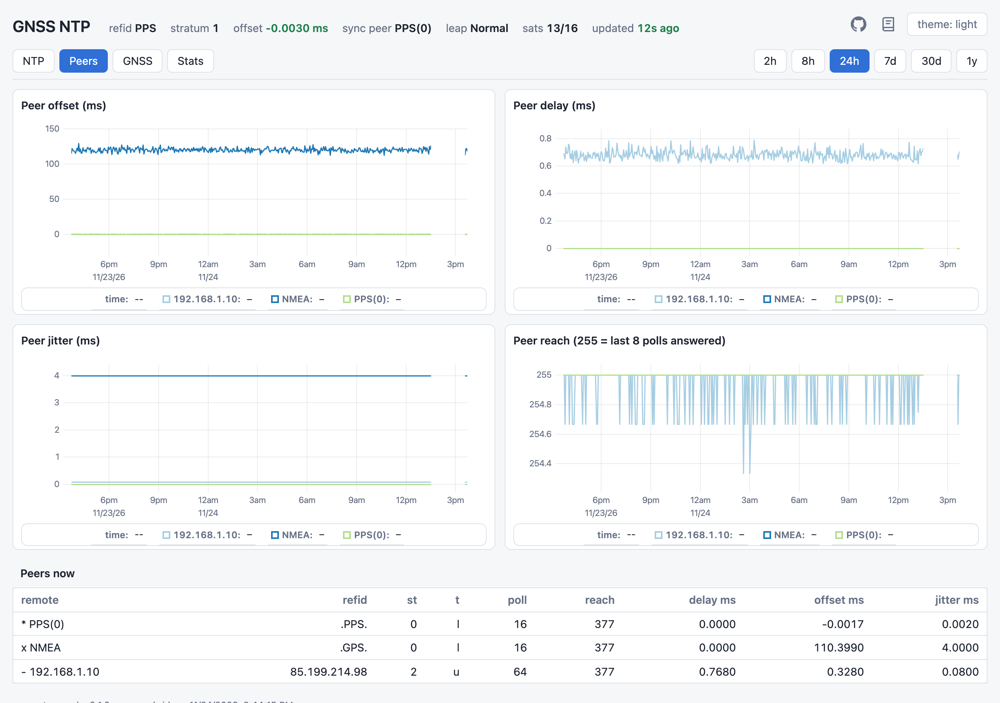
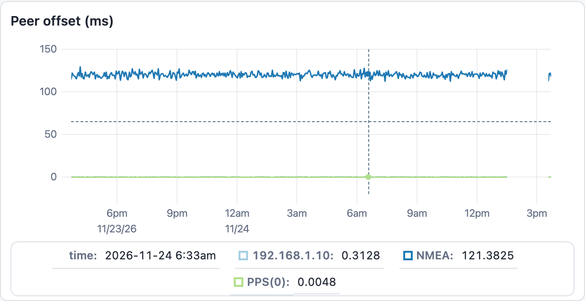
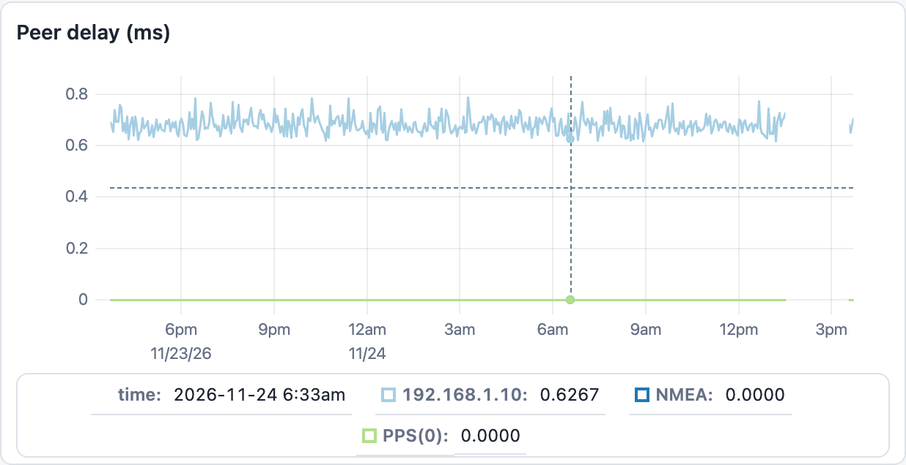
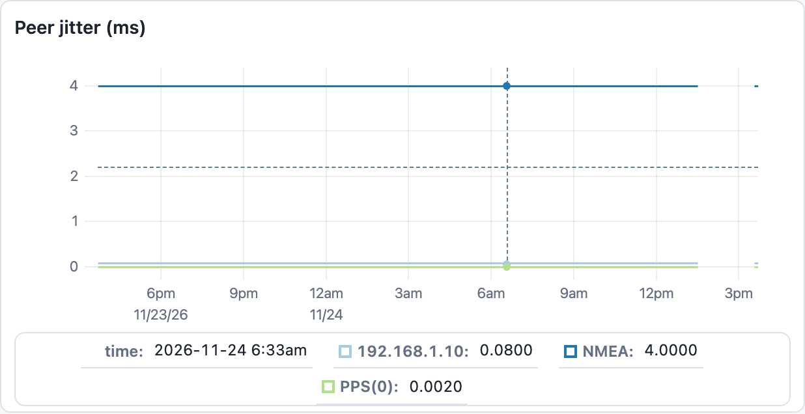
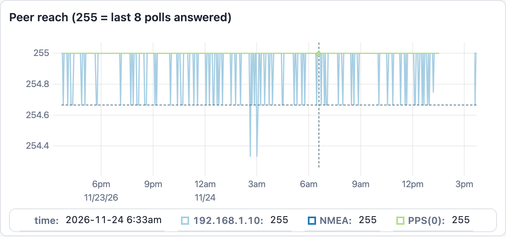
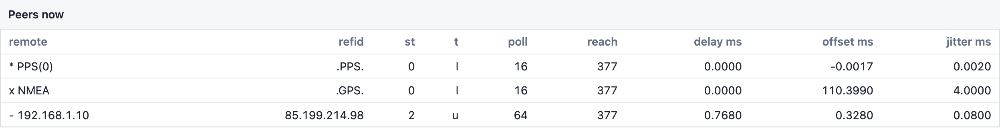

# Peers

The Peers tab shows each time source the daemon polls: the PPS and NMEA refclocks and any network servers. The data comes from `chronyc sources` and `sourcestats` for chrony, or `ntpq -pn` for ntpd.

Each graph has one line per peer, up to `max_peers` (16). When there are more, the peers with the most data in the range are drawn. `hide_peers` removes peers from the graphs by name. See [Peers settings](../configuration/web-page.md#peers).

## Peer offset

The offset of each source measured against the local clock, in ms or µs. The selected source sits near zero because the daemon steers the clock to it. The others show how far they disagree with it.

An NMEA refclock usually shows a large, steady offset (about 110 ms in the screenshot). The serial sentence arrives well after the second it describes, which is why the daemon relies on PPS for the edge and NMEA only to number the seconds. Add the NMEA name to `hide_peers` if it flattens the other lines.

## Peer delay

Round-trip network delay to each source. Refclocks have no network path and read zero. For network servers, rising delay usually means congestion on the way, and it makes their offsets less trustworthy.

## Peer jitter

Short-term noise of each source's offset. ntpd reports it directly. For chrony the collector uses the standard deviation from `sourcestats`. A good PPS source has jitter in the low microseconds. NMEA jitter is usually milliseconds.

## Peer reach

The reach register records whether each of the last eight polls got an answer, one bit per poll. The graph shows it as a decimal number:

| Value | Octal (peer table) | Meaning |
|---|---|---|
| 255 | 377 | All of the last 8 polls answered |
| 254 | 376 | The newest poll failed |
| 127 | 177 | The 8th poll back failed, the rest answered |
| 0 | 0 | No answer in the last 8 polls |

On longer ranges the graph averages reach over each bucket, so a brief loss shows as a dip to a value such as 240 instead of a clean bit pattern. A line that stays at 255 is healthy.

## Peers now

The table under the graphs lists the peers from the latest poll, in the layout of `ntpq -p`.

| Column | Meaning |
|---|---|
| remote | Tally code, then the source address or refclock name |
| refid | The source's own reference: `.PPS.` or `.GPS.` for a refclock, an address for a network server |
| st | Stratum of the source. Refclocks show 0 |
| t | Type: `u` unicast server, `l` local refclock, `s` symmetric peer. ntpd can also show `b` broadcast, `m` multicast and `p` pool |
| poll | Poll interval in seconds |
| reach | Reach register in octal, 377 when the last 8 polls all answered |
| delay, offset, jitter | Latest values, in the offset unit |

Tally codes say what the daemon thinks of each source:

| Code | ntpd | chrony |
|---|---|---|
| `*` | System peer, the clock follows it | Selected source |
| `+` | Candidate, included in the combined solution | Combined with the selected source |
| `-` | Outlier, discarded by the clustering step | Not combined, or too variable (`~`) |
| `x` | Falseticker, disagrees with the majority | Falseticker |
| `#` | Selected but not used, over the source limit | |
| `o` | PPS peer | |
| `.` | Excess, dropped from the candidate list | |
| blank | Rejected or unreachable | Not usable |

The screenshot shows a typical GPS server: PPS is the system peer, NMEA is a falseticker because its offset is far from the others, and the network server is an outlier kept as a fallback.
