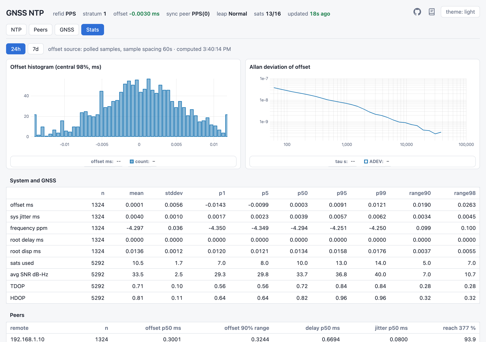
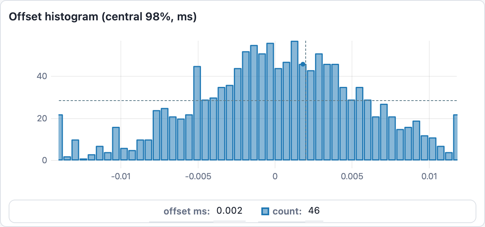
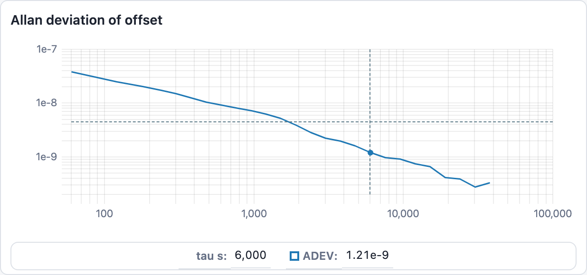
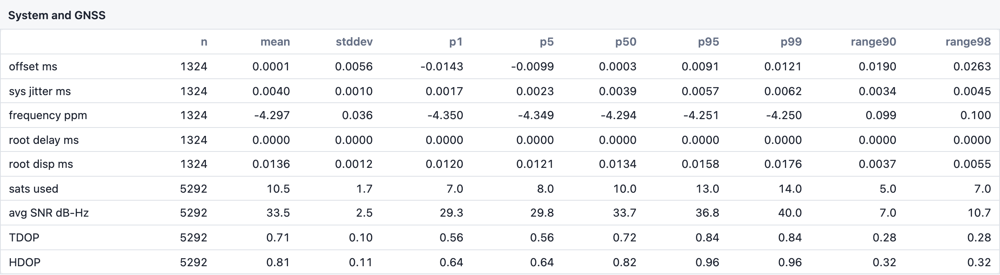
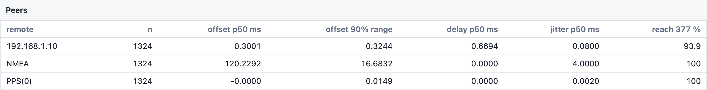

# Stats

The Stats tab summarises the server's performance over the last 24 hours or 7 days, in the style of NTPsec's `ntpviz`. The collector recomputes it every 15 minutes (`[intervals] stats`).

## Window and source

The `24h` and `7d` buttons pick the window. The range buttons are hidden on this tab.

The line next to them says where the offset figures come from and how far apart the samples are:

| Source shown | Meaning |
|---|---|
| `polled samples` | The collector's own polls, one per `[intervals] ntp` (60 s) |
| `chrony tracking.log` | chrony's statistics log, see [Daemon logs](../configuration/daemon-logs.md) |
| `ntpd loopstats` | ntpd's statistics log |

"Sample spacing" is the median gap between samples. It is the shortest averaging time on the Allan deviation graph. The time at the end says when the collector last computed the page.

## Offset histogram

How often each offset value occurred during the window, in 50 bins. The bins span the central 98% of samples, from the 1st to the 99th percentile. Samples outside that span are added to the end bins, so a tall bar at either edge holds the outliers from that side.

A narrow, symmetric peak centred on zero is what you want. A peak away from zero means a constant bias, for example an uncorrected cable or receiver delay. Two peaks usually mean the server switched between references during the window.

## Allan deviation

The Allan deviation (ADEV) measures frequency stability against averaging time tau. Both axes are logarithmic. Tau is in seconds, and ADEV is a fraction (1e-9 means one part per billion).

The collector computes the overlapping Allan deviation from the offset samples, after placing them on a regular grid at the sample spacing. It picks averaging factors about ten per decade, up to 30 points, and skips any sample triple that crosses a gap.

Read it from left to right. The curve normally falls as tau grows, because averaging cancels short-term noise. Where it flattens or turns upward, a slower effect such as temperature drift takes over. With polled samples the curve starts at 60 s, so a [daemon log](../configuration/daemon-logs.md) with finer spacing shows more of the short-term end.

## Frequency and offset vs CPU temperature

One point per bucket (5 minutes in the 24h window, 30 minutes in 7d) with the CPU temperature on the x axis and the average frequency correction or offset on the y axis. The dashed line is the least-squares fit. The caption gives:

| | |
|---|---|
| slope | Change per °C: ppm/°C for frequency, ms/°C (or µs/°C) for offset |
| r | Pearson correlation, from -1 to 1 |
| n | Number of buckets with both values |

For frequency, an r close to 1 or -1 means temperature explains most of the correction, and the slope is the crystal's temperature coefficient at this operating point. Typical crystals sit around 0.1 to 1 ppm/°C. An r near 0 means something else drives the frequency, or the temperature hardly moved in the window. Offset is normally centred on zero whatever the temperature, because the daemon steers it there. A clear slope in the offset plot means the daemon lags behind fast temperature changes; a longer poll interval or a steadier case temperature helps.

Both graphs are hidden on hosts that record no CPU temperature.

## System and GNSS table

One row per quantity, with these columns:

| Column | Meaning |
|---|---|
| n | Number of samples in the window |
| mean | Arithmetic mean |
| stddev | Sample standard deviation |
| p1, p5, p50, p95, p99 | Percentiles, with linear interpolation between samples. p50 is the median |
| range90 | p95 minus p5: the span holding the central 90% of samples |
| range98 | p99 minus p1: the span holding the central 98% |

Rows:

| Row | Source |
|---|---|
| offset | System offset (from the daemon log if configured) |
| sys jitter | System jitter |
| frequency ppm | Frequency correction (from the daemon log if configured) |
| root delay, root disp | Root delay and dispersion |
| CPU temp °C | CPU temperature of the collector's host |
| sats used | Satellites in use |
| avg SNR dB-Hz | Average signal of satellites in use |
| TDOP, HDOP | Time and horizontal dilution of precision |

range90 and range98 are the most useful single numbers for comparing periods. Unlike the standard deviation, a handful of outliers barely moves them.

GNSS rows have more samples than system rows because GPS is polled every 15 seconds instead of every 60.

## Peers table

| Column | Meaning |
|---|---|
| remote | Peer address or name. Peers in `hide_peers` are still listed here |
| n | Number of polls in the window |
| offset p50 | Median offset |
| offset 90% range | p95 minus p5 of the offset |
| delay p50, jitter p50 | Median delay and jitter |
| reach 377 % | Share of polls where all of the last 8 polls had answered (reach 377 octal) |

A reach 377 share below 100% on a network server means lost packets. On a refclock it means the receiver or gpsd dropped out.
