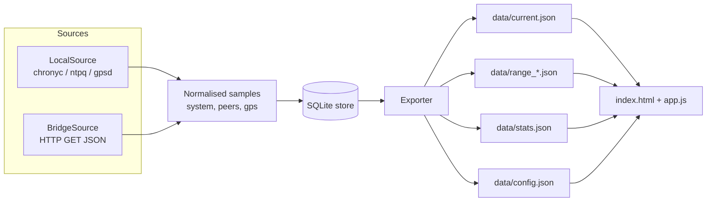
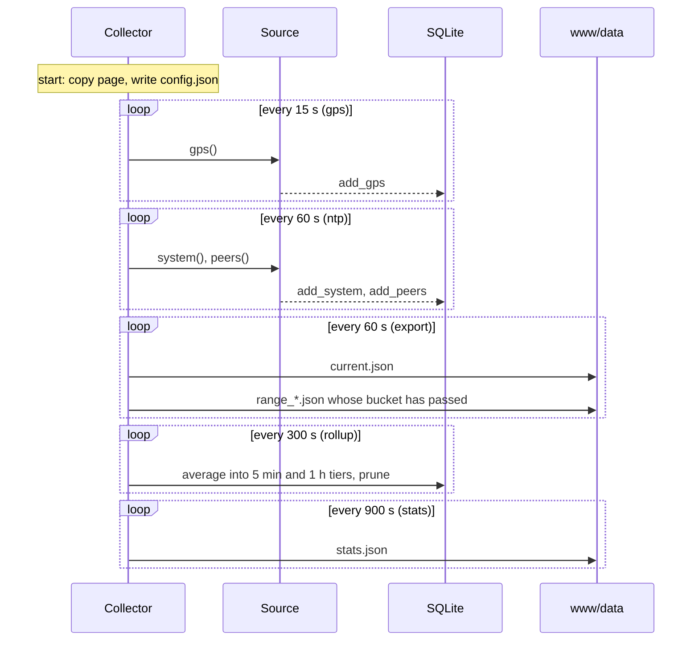
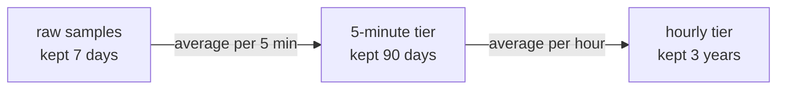

# How it works

The collector is one Python process with no third-party dependencies. It polls a source, stores samples in SQLite and writes JSON files. The browser does all the drawing, with a bundled copy of [uPlot](https://github.com/leeoniya/uPlot), so the server only serves small static files.

| Module | Job |
|---|---|
| `sources/local.py` | Runs `chronyc` or `ntpq` and reads gpsd, then converts the output to the bridge's JSON shape |
| `sources/bridge.py` | Fetches `ntpq_crv.json`, `ntpq_pn.json` and `gps.json` from the bridge |
| `sources/base.py` | Turns either shape into `SystemSample`, `PeerSample` and `GpsSample` records |
| `store.py` | SQLite tables, rollup tiers and range queries |
| `export.py` | Writes the JSON files the page reads |
| `stats.py` | Percentiles, histogram and Allan deviation |
| `logs.py` | Reads chrony `tracking.log` and ntpd `loopstats` |
| `collector.py` | Timer loop and the built-in web server |
| `config.py` | Defaults, TOML and environment loading, validation |

## One field mapping

The `local` source converts chrony output into the same JSON shape that GPSNTPHomeBridge publishes, using the same rules as the bridge's `ntp_service_chronyd.sh`. Both sources then go through one parser. That is why graphs from a Pi running `local` and a Docker host running `bridge` match.

| Field | chrony (`chronyc -c`) | ntpd (`ntpq`) |
|---|---|---|
| offset | `tracking` last offset, negated, in ms | `rv` `offset` |
| sys_jitter | `tracking` RMS offset, in ms | `rv` `sys_jitter` |
| clk_jitter | `sourcestats` std dev of the sync source, in ms | `rv` `clk_jitter` |
| frequency | `tracking` frequency, ppm | `rv` `frequency` |
| wander | `tracking` skew, ppm | `rv` `clk_wander` |
| rootdelay, rootdisp | `tracking`, in ms | `rv` `rootdelay`, `rootdisp` |
| stratum, refid, leap | `tracking` | `rv` |
| peers | `sources`, `sourcestats` and `ntpdata` | `-pn` |

Two kinds of reading are filtered on the way in:

- The bridge turns a gpsd failure into a record with zero satellites and no timestamp. The collector treats that as missing data, not as "0 satellites".
- A system reading with stratum 0 or 16 (unsynchronised) carries placeholder values. It updates the status line but is kept out of the graphs.

## Timers

The main loop runs five jobs, each on its own interval from `[intervals]`. A job that raises an error is logged and the others carry on.

All jobs run once straight after start, so the page has data within seconds.

## Storage tiers

Every table exists three times: raw samples, 5-minute averages and hourly averages.

The rollup job rebuilds only the buckets touched since its last run, then deletes rows older than each tier's retention. Text fields such as refid take the maximum value within a bucket.

When the page asks for a range, the store picks the finest tier whose retention covers the range start, then averages it into the range's bucket size. Buckets with no samples are written as `null`, which the graph draws as a gap.

| Range | Bucket | Tier (defaults) | Points |
|---|---|---|---|
| 2h | 30 s | raw | 240 |
| 8h | 60 s | raw | 480 |
| 24h | 180 s | raw | 480 |
| 7d | 20 min | raw | 504 |
| 30d | 1 h | 5-minute | 720 |
| 1y | 6 h | hourly | 1460 |

Each range file is rewritten only after its bucket length has passed, so the 1-year file changes four times a day.

The database runs in SQLite WAL mode. Each sample is written as one row per timestamp, and the peers tables have one row per peer and timestamp.

## The page

`index.html` and `app.js` are static. On load the page reads `data/config.json`, then fetches `current.json` and the range file for the selected tab every 60 seconds. It only draws the visible section, so a hidden tab costs nothing. Requests add a cache-busting query string, and the web server sends `no-cache` for `data/`.
